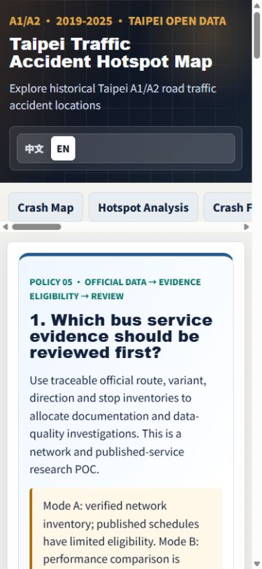
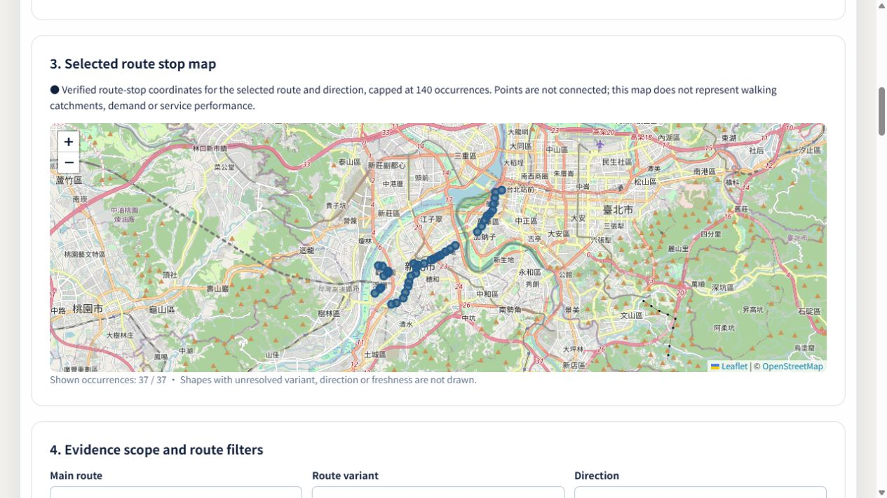

# Policy #5 — bus network and published-service delivery

Verified on 2026-10-22, Asia/Taipei. Branch: `codex/bus-network-service`. Base: `5443ee5815deac968c228fd46954ec148c8e09ed`, re-fetched and unchanged on resumption. PR #7 (Neihu) and PR #8 (Vite 8.3.4) are merged in this base. The bus module is a separate feature (`feat-007`); it does not modify Portfolio. The review PR is recorded in the current progress/handoff after publication; automatic merge is not enabled.

Read the [18-section Traditional Chinese MVP](bus-service-decision-mvp.zh-TW.md), [methodology](bus-service-methodology.md), [source audit](bus-service-source-audit.md), [independent catalogue/TDX checks](bus-service-access-notes.md) and [implementation plan](bus-service-implementation-plan.md).

## Delivered scope and evidence boundary

**Mode A: verified network inventory and limited published-service documentation. Mode B: unavailable.** The actual snapshot is `pto-bus-0b70f80504e5b952`, acquired 2026-10-21 and rebuilt from retained inputs on 2026-10-22 without changing acquisition timestamps.

The new lazy bilingual tab provides source/provenance status, main-route/variant/direction filters, selected-route stop map, raw published-service evidence, rule-based quality candidates, capacities 5/10/all, evidence-gap and balanced-main-route strategies, sensitivity and source-rich JSON/CSV briefings. Direction-specific published-service comparison is ineligible because timetable records have no accepted direction assignment. There are no actual Taipei operational events, executed-trip completeness denominators, demand estimates, service-shortage scores or reliability results.

The historical engine has a separate type and eleven explicit gates. Unit fixtures test its behavior but are not Taipei observations. No dashboard control can promote published plans, GPS or arrival estimates into actual completed-trip evidence. No backend, live tracking service, journey planner or new dependency was added.

## Official sources, versions and access

PTO's API v6.3 document and eight documented production gzip feeds were acquired successfully. Original compressed total: **5,586,935 bytes**. The acquisition interval is **2026-10-21T07:08:14.272Z–07:08:16.679Z**. All eight returned HTTP 200 without credentials. Original hashes, source update strings and HTTP Last-Modified are separately recorded in `data/raw/bus-service/manifest.json` and the source audit's full SHA256 table.

| Production resource under `https://tcgbusfs.blob.core.windows.net/blobbus/` | Raw records | Original compressed bytes | Supported use |
| --- | ---: | ---: | --- |
| `GetRoute.gz` | 800 | 77,393 | Main-route, variant and operator associations; raw service text |
| `GetStop.gz` | 28,826 | 1,420,511 | Route-specific stop posts, main-route reference and direction |
| `GetStopLocation.gz` | 5,376 | 179,867 | Distinct physical locations |
| `GetPathDetail.gz` | 43,447 | 345,277 | Subsidiary stop occurrences and order |
| `GetSemiTimeTable.gz` | 3,280 | 19,759 | Published variant headway windows, direction unresolved |
| `GetTimeTable.gz` | 35,465 | 194,850 | Published variant dispatches/calendar, direction unresolved |
| `GetBusShape.gz` | 1,028 | 3,299,688 | Main/subroute geometry identity and age audit |
| `GetSpecTimeTable.gz` | 282 | 49,590 | Special preplanned schedule audit, not executed trips |

The v6.3 PDF is retained separately with a reference manifest: 628,974 bytes, SHA256 `642a0177bb63b990be90a03017d82e8b72a761eab8aac3e0fc1c7ed3614505c4`. Its acquisition date is known, exact time unrecorded; no exact time was invented. Raw originals, references and browser-facing artifacts remain distinct.

PTO's open-data declaration and the official document linking these eight URLs form the documented licence chain; direct Taipei Stop/BusShape catalogue licences corroborate it. Attribution is retained in the UI, feed URLs and provenance; derived priorities are not agency-endorsed ratings. Applying the publisher-wide grant to its documented external blobs is explicitly identified as a publication interpretation in the source audit.

The reference audit separately checked all four requested Taipei catalogues, metadata CSV pointers, `TstStop.json`, `TstBusShape.json`, historical SHP, MRT exit information, TDX supply matrix, v2/v3/history documentation and the 2026-10-16 announcement. The announcement's bus additions are OD fares, not newly complete executed-trip histories. v3 selection did not render a usable definition in that check; this is an access limitation, not proof v3 absent. Taipei daily timetable/daily-stop availability is not established by generic endpoint names. Exact reference retrieval statuses/hashes and limits are documented rather than copied into production inventory.

No authenticated TDX data was acquired. A future integration must verify client membership, subscription, endpoint, Taipei retained coverage, service-specific quotas and event semantics. `TDX_CLIENT_ID` and `TDX_CLIENT_SECRET` would remain offline environment variables; the current source pipeline does not implement an OAuth archive client or require them. Guest/basic quotas are not historical-member entitlements. Source access failure never establishes absent public service.

## Actual identity joins, exclusions and Mode A metrics

| Metric | Retained result and interpretation |
| --- | --- |
| Main-route IDs | **416** |
| Subsidiary IDs | **731** |
| Distinct main/variant/operator associations | **773**; 42 additional associations beyond variants, plus 27 identical repeated association rows in the 800 raw rows |
| Stop posts / physical locations | **28,826 / 5,376**, different units |
| Path occurrences | **43,447**; repeated visits preserve native occurrence IDs |
| Missing variant references | **212**, retained in quality report, excluded from verified candidate inventory |
| Stop.routeId → Route.Id | All 28,826 resolve to main-route identities |
| PathDetail.stopId → Stop.Id | 0 unresolved stop references |
| Stop.stopLocationId → StopLocation.id | 0 unresolved location references |
| Duplicate stop IDs / invalid stop coordinates | 0 / 0 in this retained edition |
| Normalized variant/direction review units | **1,241** |
| Exact main+subsidiary+direction geometry matches | **216**; no main-route shape copied across subsidiaries |
| Direction-specific published-service comparison | **0 eligible**; raw variant schedules remain inspectable |
| Actual historical performance | **0 eligible**, no acquired actual event population |
| Administrative/geographic representation | Cross-border PTO network; no verified district allocation or population denominator |

Native `Stop.routeId` is a **main** ID, while `PathDetail.pathAttributeId` is a subsidiary ID. Direction comes from the referenced stop; PathDetail.Type is not direction. Names are never join keys. Conflicts/missing coordinates become quality issues, not guessed relationships. Missing coordinates remain null and broken route-stop references cannot become verified mapped occurrences.

The raw civil update strings on ordinary feeds have no explicit timezone; they are source metadata, not operational event timestamps. BusShape has per-row update age, so a fresh feed download does not certify current route geometry. Special preplanned timetables are not completed trips. Actual service period, comparable operating days, expected-versus-executed completeness, outages, service exceptions and holidays remain unavailable. Missing records do not mean zero buses or missed trips.

## Explainable priorities and actual scenarios

Default objective is network/documentation quality, strict verified-identity inclusion, all source routes/variants/directions. There are **1,241 eligible quality candidates, 0 excluded**: **A 163, B 927, C 151**. A denotes primary relationship/sequence verification, B published-documentation gaps, C lower-priority documentation/geometry review. Tier and stable composite IDs determine order. Equivalent tiers do not imply a hidden numerical service-quality score.

| Capacity | Evidence gaps selected / main routes | Balanced selected / main routes | Strategy selection difference |
| --- | --- | --- | --- |
| 5 | 5 / **2** | 5 / **5** | 3 added / 3 removed |
| 10 | 10 / **5** | 10 / **10** | 5 added / 5 removed |
| All eligible | 1,241 / **416** | 1,241 / **416** | Identical set; ordering may differ |

Capacity 5 exact IDs:

| Position | Evidence Gaps First | Balanced Main-route Review |
| --- | --- | --- |
| 1 | `pto:10419:104190:0` | `pto:10419:104190:0` |
| 2 | `pto:10419:104190:1` | `pto:10432:10432:1` |
| 3 | `pto:10432:10432:1` | `pto:10471:104710:0` |
| 4 | `pto:10432:157849:1` | `pto:10724:107240:0` |
| 5 | `pto:10432:159403:1` | `pto:10734:107340:0` |

Capacity 10 adds to the evidence-gap list `pto:10471:104710:0`, `pto:10471:104710:1`, `pto:10724:107240:0`, `pto:10724:107240:1`, `pto:10734:107340:0`. Balanced capacity 10 adds to its list `pto:10754:10754:0`, `pto:10831:159500:1`, `pto:10841:108410:0`, `pto:10844:108440:0`, `pto:11031:11031:0`.

These are investigation units, not service cuts, capacity improvements or passenger benefits. Balanced review cycles among verified main-route identities; no district diversity is claimed. Default and broader ambiguity-review settings both yield 1,241 for the actual edition, so the UI reports no population/selection change rather than inventing a sensitivity effect. Source edition, route/variant/direction and eligibility changes are different evidence scopes; absent edition metadata cannot be certified as same scope. Neither broader setting grants published-direction or historical-performance eligibility.

## Static architecture, safety and exact payloads

Acquisition is explicit and offline with exact URL allowlist, 30-second timeout, at most three attempts, bounded exponential backoff, Retry-After handling, 16 MiB compressed and 64 MiB decompressed limits. Fatal UTF-8, envelope, IDs, scalar fields, sequence and provenance validation reject schema drift before publication. No unrelated scripts, traces, credentials or embedded external HTML scripts are copied into application assets. Published raw fields are explicit network/schedule whitelists.

Original and generated artifacts use immutable, atomic writes. A complete edition's root manifest rename is the publication commit point. Failed fetch, bad hash, malformed sequence or a write collision preserves the previous manifest. GeneratedAt comes from retained acquisition, not rebuild/browser time. Both raw traffic inputs and integrity-pinned public JSON disable Git newline conversion through `.gitattributes`.

Heavy source joining occurs offline. The browser loads the independent bus manifest and compact index only after entering the tab; selected main-route details are lazy, hash/schema checked, shared in flight and cached with a bounded detail cache. At most **140** valid selected-route stop occurrences are plotted. No thousands of initial markers, dynamic API calls or large PWA precache additions.

| Artifact / measurement | Actual result |
| --- | --- |
| Root manifest | **83,384 bytes** |
| Initial snapshot/index | **563,601 bytes** |
| Initial bus JSON total | **646,985 bytes** before HTTP compression, fetched only on tab entry |
| Referenced public files | **420**, including **416 route details** |
| All referenced JSON combined | **28,239,649 bytes** plus root manifest; never one initial download |
| Route detail min / median / max | **6,408 / 51,305 / 673,763 bytes** (largest main route 11138) |
| Main route 10132 detail | **50,814 bytes**, 75 directional occurrences, 32 variant schedule records |
| Lazy dashboard JS | **45.43 kB raw / 16.27 kB gzip** |
| Lazy dashboard CSS | **2.98 kB raw / 1.02 kB gzip** |
| Balanced scenario local Node benchmark | 1,241 candidates, capacity 10, 10,000 iterations; mean **0.3622 ms** |
| One local HTTP read+parse per artifact | Manifest **32.8 ms**, snapshot **11.2 ms**, selected route 10132 **4.4 ms**, each HTTP 200 |

These local timings include neither a public deployment guarantee nor mobile-network render latency. Route-selection behavior was measured through actual requested detail size/contents and visible marker count; a browser render-latency target was not benchmarked. Initial-page absence of bus requests, independent accident/Neihu data and cached route remounts are asserted in integration tests.

## Commands executed and outcomes

Base checks on 2026-10-21 passed 66 existing tests. Resume checks on 2026-10-22:

| Command/check | Actual outcome |
| --- | --- |
| `git fetch origin main` | Base remains `5443ee5815deac968c228fd46954ec148c8e09ed` |
| `npm ci` | Passed; no lock/dependency changes; audit reports **2 moderate vulnerabilities** in existing dependencies |
| `npm run data:fetch:bus-service` | Passed, **validated retained edition**, no fresh live acquisition claimed |
| `npm run data:audit:bus-service` | Passed all eight original hashes, schemas and joins |
| `npm run data:build:bus-service` twice | Passed, byte-identical manifest and referenced files |
| Root manifest SHA256 | `00c1f33198ef811a46bddc784119063b2ce3174c5dbe3224ba0b662098d02b7b` |
| `npm test` | **99 tests / 7 files passed** |
| `npm run build` | TypeScript and Vite 8.3.4 passed |
| `./init.sh` via installed Git Bash | Final build and **99 tests passed** |
| `GITHUB_PAGES=true npm run build` | Passed `/taipei-crash-map/` configuration |
| Pages bus/Neihu integration suites | **11 tests / 2 files passed** |
| `node --check public/sw.js` | Passed; service-worker source unchanged |
| `git diff --check` / staged check | Passed before publication |
| Legacy `convert:accidents` | Not run; accident contracts unchanged |

PowerShell used `$env:GITHUB_PAGES='true'`; Git Bash ran the existing harness. Some unprivileged Vitest launches hit sandbox temporary-cache EPERM; the complete suites were rerun successfully with approved execution. One integration fixture initially failed after stricter manifest validation; it was corrected to use a valid changed-edition manifest and now exercises the actual edition-mismatch guard. An independent review found malformed sequence numbers could become null after publication; source validation now rejects them before replacing the manifest. No remaining P1/P2 findings were reported in the reviewed pipeline/engine/hooks.

Source tests cover compression/encoding/expansion bounds, missing/duplicate IDs, strict versions/hashes/paths, coordinates/WKT, malformed scalars/sequences, rate limits, permanent failures, immutable acquisition and last-good publication. Engine tests cover main/subroute separation, directions/loop occurrences, calendars, headway text, midnight/service days, historical gates, deterministic tiers/capacities, balanced representation, empty/identical sets, different editions, sensitivity and formula-safe exports. Integration tests exercise actual retained fixtures for bilingual loading/error/retry, no initial bus fetch, Pages paths, detail caching/hash/edition rejection, filtering, scenarios and real-ID/provenance downloads. Synthetic edge cases remain test-only. The visible timetable page also presents parsed weekday/date and published clock-window interpretation beside raw strings, with explicit timezone/rollover assumptions and unverified headway bounds. Only the ten visible rows are parsed in the browser; source-wide validation and joins stay offline.

## Browser evidence and screenshots

Actual development and final production previews were inspected. Production URL: `http://127.0.0.1:4180/taipei-crash-map/`. Existing crash-map summary remained **167,550** records and Neihu readiness remained **58** devices. The bus tab loaded the correct integrity-pinned edition, bilingual inventory, candidate/strategy controls and disabled Mode B.

Desktop document width/scroll width: **1265/1265 px**; mobile content **375/375 px** inside the requested 390×844 viewport. No document horizontal overflow. The selected main route 10132, outbound direction, displayed **37/37** valid points without connecting them; its 32 raw variant schedule records remained direction-unassigned. After zooming the map, changing review capacity preserved the SVG view and all 37 point positions. A selected-route filter changes the investigation population and exports independently of global scenarios.

Production balanced capacity-10 JSON and CSV downloads both completed. Inspection verified **10 candidates, 10 represented main routes, eight source records/hashes, the snapshot evidence edition, and `historicalPerformanceEligible=false`**. CSV retained eight provenance rows. Captured console error log was empty. English mobile briefing and Chinese desktop evidence states were inspected.

These screenshots are intentionally retained for delivery. Existing accident, crash-factor, violation, appraisal, Neihu utilities and integration checks pass; accident/Neihu code and service-worker behavior were not refactored. A full physical-device PWA installation/offline lifecycle and manual replay of every legacy dashboard control were not performed. There is no new dedicated E2E script or dependency.

## Requirements-to-evidence matrix

| Acceptance item | Evidence / boundary |
| --- | --- |
| 1 Current GitHub structure | Latest main fetch, merged PR #7/#8, base SHA recorded |
| 2 Independent official-source check | PTO PDF + eight feeds; separate catalogue/TDX audit |
| 3 Actual records and limitations | Original hashes/times/counts; raw vs published evidence separated |
| 4 Route/stop/schedule semantics | Main/variant/operator/direction keys, StopLocation distinction, retained occurrences and raw calendar strings |
| 5 Reproducible offline ETL | Explicit fetch/audit/build, byte-identical repeated output |
| 6 Invalid inputs cannot corrupt snapshot | Early schema/provenance rejection, immutable files and atomic manifest, last-good failure tests |
| 7 Verified inventory where possible | 416 main routes, 731 variants, real selected-route details; 212 orphan path records explicitly excluded |
| 8 Explainable quality candidates | 1,241 units, A/B/C rule codes, stable ordering and exported reasons |
| 9 Functional capacities | Actual 5/10/all, both strategies and changed selections |
| 10 Evidence-aware sensitivity | Strict/broad inclusion; same result honestly shown; edition/filter scope warnings |
| 11 Historical gate | Mode B disabled, independent typed engine tested without publishing fixture results |
| 12 Bilingual desktop/mobile | Integration tests and real responsive browser/screenshots |
| 13 GitHub Pages | Build, 11 deployment-base integration tests, actual production data/details/downloads |
| 14 JSON/CSV | Real balanced-10 downloads verified against source IDs/metadata; injection tests |
| 15 Accident/Neihu preserved | Existing tests pass, code unchanged, actual map/Neihu states inspected |
| 16 Performance and sizes | Actual table above; local scope and unmeasured render latency explicit |
| 17 Tests/builds executed | 99 tests, both builds, final harness, scoped ETL, static checks |
| 18 Documentation/handoff | MVP, methodology, audit, access supplement, this delivery, README/tracker/progress/handoff |

## Changed files, limitations and future case-study inputs

The feature adds four isolated source scripts, raw compressed inputs/reference provenance, versioned public manifest/index/detail/report files, independent bus types/time/decision/export utilities, lazy hook/dashboard/point map/scoped CSS, three test suites and six bus documents. Existing-file changes are restricted to tab/translations/full-width CSS selector, three npm scripts, exact-byte Git attributes and project documentation/tracking. No dependency/lockfile, accident converter, Neihu decision engine, service worker or Portfolio changes.

This is a **network inventory and documentation review POC**, not a fully verified service-coverage or operational-performance analysis. Remaining inputs: resolve orphan variants and source-version continuity, verify variant/direction calendar applicability, validate row-level geometry freshness and administrative crosswalks, and obtain lawful historical actual events with service-day/holiday/exception and expected-observation denominators. Review the existing two moderate dependency advisories separately rather than changing unrelated packages here.

Future Portfolio Case Study 007 can use the licence/source audit, exact entity-resolution rules, 212 unresolved references, capacity strategy examples, unchanged-scope comparisons, reproducibility evidence and measured payloads/screenshots. It must disclose blocked historical and coverage claims; it must not infer demand from population, missed trips from telemetry gaps, inefficiency from route overlap, or intervention benefits from a review shortlist. No Portfolio edits or automatic PR merge are included in this task.
