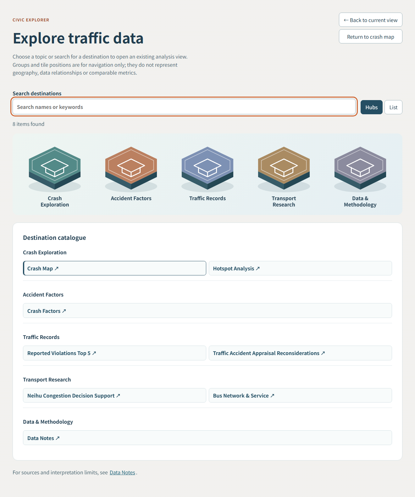
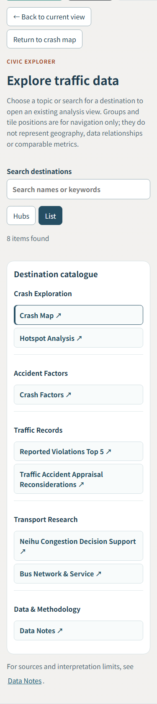

# Traffic Map Civic Explorer delivery

2026-11-02 · **PASS_WITH_LIMITATIONS** · branch `codex/civic-explorer`, baseline `b2253fe` (latest main at startup), synchronized with upstream `092b211` before handoff. [Draft PR #12](https://github.com/LEO0331/taipei-crash-map/pull/12); human merge only.

## Final design and mapping

The crash map remains the default. An optional Civic Explorer button sits beside the eight original direct destination buttons. Five native button hubs use layered SVG hexagons, visible sides, restrained shadows, selection and keyboard focus. Search and list mode expose the existing destinations; mobile defaults to the list and can switch to hubs. Hubs are navigation categories, never geographic positions, joined datasets or comparable indicators.

| Hub (English / Traditional Chinese) | Existing AppTab targets |
| --- | --- |
| Crash Exploration / 事故探索 | `crashMap`, `hotspotAnalysis` |
| Accident Factors / 事故因素 | `crashFactors` |
| Traffic Records / 交通紀錄 | `reportedViolations`, `appraisalReconsiderations` |
| Transport Research / 運輸研究 | `neihuCongestion`, `busService` |
| Data & Methodology / 資料與方法 | `dataNotes` |

Destination labels come from the existing bilingual translation object. Back returns to the mounted current view and restores entry focus/scroll; Return to crash map selects `crashMap` without resetting accident controls. Reset clears only Explorer search/group selection. Escape clears the selected group and restores hub focus. Search is scoped to the selected hub. Selection focuses the existing workspace. Reduced motion removes tile lift; native buttons support Enter/Space. The eight direct buttons remain available during loading or failure.

## Component reuse and attribution

Adapted the native React 19 SVG/CSS pattern from [real-estate CivicExplorer](https://github.com/LEO0331/taipei-real-estate-dashboard/blob/main/src/CivicExplorer.tsx), rather than copying Portfolio's React 18 router. Tile geometry originates in [Portfolio v3.0.1 HexIsland](https://github.com/LEO0331/portfolio/blob/v3.0.1/src/components/explorer/HexIsland.tsx). The complete MIT permission/warranty notice and Copyright (c) 2026 LeoChen remain in `src/components/CivicExplorer.tsx`; CSS includes its attribution pointer. Reference inspection also covered Portfolio's generic Explorer API and its documented previous merged Dashboard integrations. No edits to either reference repository.

The adapter `src/utils/explorer.ts` contains only IDs, labels and immutable search. App owns `activeTab`, language, filters and map mode. Explorer owns temporary query/group/view state. Lazy import and a return-capable error boundary isolate the optional UI. Existing analytical dashboards retain their original import/mount boundaries. Opening Explorer hides the current workspace without unmounting it; a resize notification on reveal lets Leaflet remeasure after an orientation change. Switching destinations keeps the pre-existing mount/unmount behavior of those modules.

## State and analytical regression evidence

- Before implementation, an archived `b2253fe` build with the same installed lockfile dependencies showed Chinese/crashMap/hotspots, eight direct destinations, no overflow at 1440/375, no raw accident or research-module requests. Existing summary/hotspots, violations and reconsideration hooks still make their baseline requests. See [baseline JSON](civic-explorer-baseline.json).
- New unit/integration tests cover exact mappings, both languages, literal/scoped search, reset, selection, current destination, native controls, Escape/focus, mobile default list, mounted-map local state, preserved accident filters/mode, return navigation, language/URL and deferred research factories.
- Real Chromium checks at 1440×1000 and 375×1000: five hubs/eight destinations, English/Chinese, search, reset, Enter, Escape/focus, reduced-motion computed styles, no horizontal overflow, same Leaflet DOM identity after Back, retained search and cluster mode, resize while hidden and working zoom on return. Root checks additionally explicitly retain district, morning period and year selection. Both deployment bases open bus/Neihu from Explorer and observe their successful on-demand manifest/snapshot requests. Opening Explorer itself requests neither research module. Normal-path page errors: zero.
- Optional chunk download aborted deliberately: error boundary returns to visible map and direct Data Notes still works. Production SW has the original scope/script/cache name. A visited Explorer survives an offline page reload. First-ever offline use of an uncached chunk remains subject to the existing cache policy and gets the return-capable fallback.
- `git diff --exit-code origin/main -- public data src/hooks src/types src/i18n.ts src/utils/accidents.ts src/utils/busService.ts src/utils/trafficCongestion.ts package.json package-lock.json vite.config.ts .github` passed. Existing analytical components and converter/export scripts are unchanged; only the new browser acceptance script was added under scripts. No source snapshots, ETL outputs, metrics, policy features, thresholds, denominators, filters or research readiness rules changed. No new causation/risk/safety/liability/reliability/congestion claims.

## Performance

Exact bytes below use Node `gzipSync` defaults consistently for baseline/final. Vite's console gzip figures use different compression settings; do not mix the two. [Full filenames and measurements](civic-explorer-performance.json).

| Asset | Baseline root raw / gzip bytes | Final root raw / gzip bytes |
| --- | ---: | ---: |
| Entry JS file | 423,153 / 126,846 | 417,495 / 125,232 |
| Static JS dependency | 0 / 0 | 8,567 / 3,265 |
| **Total entry JS** | **423,153 / 126,846** | **426,062 / 128,497** |
| Main CSS | 27,306 / 9,629 | 27,460 / 9,677 |
| Optional Explorer JS | absent | 5,562 / 2,385 |
| Optional Explorer CSS | absent | 4,903 / 1,440 |

Total entry JS grows **2,909 raw / 1,651 gzip bytes** (~0.69% / 1.30%). The smaller entry filename alone is not a reduction: Vite extracts a shared JSX runtime. The optional Explorer adds 10,465 raw / 3,825 gzip bytes (JS + CSS); its shared runtime is already counted in initial JS. Final Pages entry total is 426,096 / 128,520 bytes. No new dependencies, WebGL or data loading code. Dashboard/research chunks remain separate; no claim of public-network latency or low-end-device benchmark.

## Verification and reproduction

- `npm ci` using the existing lockfile: passed, no package/lock changes.
- Baseline `npm test`: **99 tests / 7 files**, passed; baseline production build passed.
- Final Git Bash `./init.sh`: passed; `npm test`: **106 tests / 9 files**, passed; `npm run build`: passed.
- Root and `GITHUB_PAGES=true npm run build -- --manifest`: passed. Preview must use the same `GITHUB_PAGES` value as its build.
- `git diff --check`, protected-file diff, `node --check public/sw.js`: passed.
- `npm audit --omit=dev`: **0 vulnerabilities**. The initial full audit found **1 high-severity development dependency (`undici`)**. Upstream merged Dependabot PR #11 while this feature was in progress; synchronized `092b211` (only package-lock.json changed upstream), repeated clean install/harness and full `npm audit --json`: **0 vulnerabilities**. No feature-specific dependency changes. Initial Windows clean-install retry encountered a native binding locked by our preview child; stopping that confirmed process resolved it.
- Run optional Chromium acceptance with an existing Playwright module: set `PLAYWRIGHT_MODULE` to its module path and `EXPLORER_BASE_URL` to root or the Pages preview URL, then `node scripts/checkCivicExplorer.cjs`. This session reused Portfolio's installed Playwright, without adding a project dependency. The runner saves JSON/screenshots under ignored `.omx` by default. Retained [Pages evidence](civic-explorer-browser-evidence.json) and [root evidence](civic-explorer-root-browser-evidence.json).

Initial sandbox test temporary-file renames and localhost isolation failed; rerunning verification with the approved unrestricted execution context resolved them. Initial Git Bash was similarly retried successfully. No browser checks remain blocked. Remote production deployment, physical mobile install, Safari/Firefox and assistive-technology sessions were not performed. Deployment is intentionally deferred to human merge. Existing large SW precache and baseline hook requests are unchanged.

## Screenshots

Desktop English, five-hub overview:

Mobile English, default compact list:

Mobile Traditional Chinese, optional hub mode:

## Handoff

Review this single Draft PR and merge manually only. Keep the original AppTab IDs and analytical boundaries. Reproduce with `AGENTS.md`, `feature_list.json`, `progress.md`, `./init.sh` and the browser runner above. Remaining work is human review/deployment. Status **PASS_WITH_LIMITATIONS** reflects unperformed physical-device, other-browser and remote-deployment checks.
